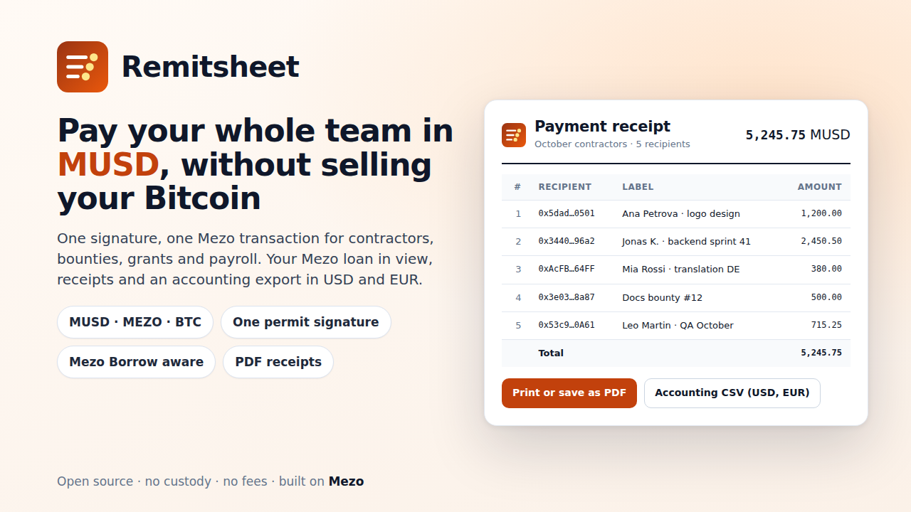

# Remitsheet for Mezo

**Pay your whole team in MUSD, without selling your Bitcoin.** One signature, one Mezo transaction, a receipt and an accounting export.

Remitsheet is a small, open-source payout tool for anyone who pays many people at once: contractors, bounty and grant winners, DAO contributors, payroll. Paste or upload `address,amount,label`, check every line, and pay everyone in a single transaction on [Mezo](https://mezo.org), in **MUSD**, **MEZO** or **BTC**. MUSD and MEZO batches need just **one EIP-2612 permit signature**, with no separate approval. While you pay, the app reads your **Mezo Borrow** loan live, so you can see what borrowing the shortfall against your BTC would do to your loan-to-value. Afterwards you keep the paperwork: a printable receipt, a payment advice per recipient, and an accounting CSV with USD and EUR values.

- **Live app:** https://aratass.github.io/remitsheet-mezo/ *(GitHub Pages, from the `docs/` folder; Mezo testnet by default)*
- **Contract:** `0xfB87f0a4df8Fa0FBBe505BF4Af27aEEebEafA570`, the same address on Mezo testnet and mainnet (CREATE2)
- **Testnet deployment and first receipt:** *links added after the first testnet batch*
- **Pitch video (1 min 55 s, demo recorded on a local test chain):** [`submission/pitch-video.mp4`](submission/pitch-video.mp4) · **Deck:** [`submission/deck.pdf`](submission/deck.pdf)
- **Origin:** Remitsheet started as a USDC and EURC payout tool on Arc ([aratass/remitsheet](https://github.com/aratass/remitsheet)). This repository is its Mezo edition: the permit flow, the Mezo Borrow credit line, MUSD, MEZO and BTC support, BTC valuation from Mezo's PriceFeed and payment request links were built for the Mezo Buildathon.



## What it does

1. **Check the sheet.** Comma, semicolon or tab separated, header optional, labels optional. Every line is validated before anything can be sent: address format and EIP-55 checksum, zero address, duplicates, zero amounts, more than 8 decimals, amounts split by an unquoted thousands separator, and addresses that are token, oracle or Mezo Borrow contracts rather than people (MUSD sent to its own token contract is refused, for example).
2. **Pay in one transaction.**
   - **MUSD and MEZO:** the app checks the token's `DOMAIN_SEPARATOR()` against the expected EIP-712 domain, asks the wallet to sign a permit for **exactly** the batch total (free, valid 30 minutes), and calls `payTokenWithPermit`. One signature, one transaction, and no allowance is left behind. Tokens without a usable permit fall back to approve + pay; an existing allowance is used directly.
   - **BTC** is Mezo's native gas token, so a BTC batch is a single `payNative` transaction, down to the satoshi.
   - Before the wallet is asked to sign, the batch is simulated. If a recipient would reject the payment, the failing line is highlighted and the Pay button stays disabled. The button also stays disabled while the balance is short.
3. **See your credit line (MUSD).** If the network has Mezo Borrow, the Pay page reads your trove from `TroveManager`, the BTC price from Mezo's `PriceFeed` and the fee from `BorrowerOperations`: collateral, debt, loan-to-value, how much you could still borrow up to 50% loan-to-value, and, when the batch is short, how far borrowing the missing MUSD would move your loan-to-value. A button takes you to [Mezo Borrow](https://mezo.org/borrow) to do it.
4. **Collect requests.** A contractor or grant winner makes a **payment request link** (address, amount, asset, note). When you open it, Remitsheet offers to add that line to your sheet, so you can collect a whole team and pay everyone at once. Nothing is stored on a server.
5. **Keep the paperwork.**
   - **Receipt page** (`?tx=0x…`): rebuilt from the transaction logs on every visit, so anyone with the link can check it. It prints cleanly to an A4 PDF.
   - **Payment advice** (`?tx=0x…&to=0x…`): the receipt filtered to one recipient's line.
   - **Accounting CSV:** one row per payment plus one for the network fee, with USD and EUR values and their sources in every row.

Labels never go on-chain. They stay in your browser (saved when you send) or can be re-attached to a receipt from your original CSV.

## How it uses MUSD and MEZO

| Mezo piece | How Remitsheet uses it |
|---|---|
| **MUSD** (`0x1189…c503` testnet, `0xdD46…F186` mainnet) | Main payout asset. EIP-2612 permit with domain "Mezo USD" v1, checked against `DOMAIN_SEPARATOR()` before signing. Valued at 1 USD in the export. |
| **MEZO** precompile (`0x7B7c…0001`) | Payout asset for grants and community rewards. Its permit returns a bool and only accepts v = 27 or 28; the contract handles both permit styles. |
| **BTC** (native gas token, 18 decimals) | Payout asset (`payNative`) and network fee, shown in satoshis. |
| **Mezo Borrow**: `TroveManager`, `PriceFeed`, `BorrowerOperations` | Read-only credit line panel: collateral, debt, loan-to-value, room to borrow, effect of borrowing the shortfall (borrowing fee included). |
| **PriceFeed** at a past block | BTC lines and the network fee are valued at the BTC/USD price Mezo Borrow used at the payment block. |

All addresses and values were checked on chain on 13 October 2026; see [`MEZO-FACTS.md`](MEZO-FACTS.md).

## How to use

1. Open the app and connect a browser wallet (Rabby or MetaMask; any EIP-6963 wallet is discovered). The app offers to add or switch to Mezo testnet (chain 31611); Mezo mainnet (31612) works the same way.
2. Paste your sheet or upload a CSV, or click **Load example** to see the format (the example addresses are blocked on purpose). Or open payment request links from your team.
3. Pick **MUSD**, **MEZO** or **BTC**, set a reference (up to 32 bytes, stored on-chain), check the fee estimate and press **Pay**.
4. Open the receipt: print or save it as PDF, download the accounting CSV, copy advice links for recipients.

Test BTC and MEZO come from the [Mezo faucet](https://faucet.test.mezo.org/). Test MUSD can be borrowed or swapped in the [Mezo testnet app](https://testnet.mezo.org).

## The contract

[`contracts/src/Remitsheet.sol`](contracts/src/Remitsheet.sol): Solidity 0.8.30, no dependencies, no owner.

| Function | What it does |
|---|---|
| `payNative(address[] to, uint256[] amounts, bytes32 ref)` payable | Pays BTC. `msg.value` must equal the sum of `amounts`. |
| `payToken(address token, address[] to, uint256[] amounts, bytes32 ref)` | Pays an ERC-20 with an existing allowance, moving tokens from the caller straight to each recipient. |
| `payTokenWithPermit(token, to, amounts, ref, deadline, v, r, s)` | Validates the lines, calls `permit(msg.sender, this, total, deadline, v, r, s)` for exactly the total, then pays. |

- **Permit safety:** the permit owner is always `msg.sender`, so a copied signature cannot move anyone else's tokens. If someone front-runs the permit from the mempool, the batch still succeeds because only the resulting allowance is checked; if the allowance is still short, it reverts with `PermitFailed(total, allowance)`. Works with permits that return nothing (OpenZeppelin, MUSD) and permits that return a bool (Mezo's precompiled tokens).
- **Events:** `Paid(ref, token, to, amount)` for every line, then `BatchPaid(ref, sender, token, total, count)`. A receipt can be rebuilt from the logs alone.
- **Errors** carry the failing index: `TransferFailed(index, to)`, `ZeroAddress(index)`, `ZeroAmount(index)`, `ValueMismatch`, `LengthMismatch`, `EmptyBatch`, `InvalidToken`, `PermitFailed`.
- **Deployment:** through the standard CREATE2 factory (`0x4e59b44847b379578588920cA78FbF26c0B4956C`, present on Mezo testnet and mainnet) with salt `"Remitsheet v2"`, so the address is `0xfB87f0a4df8Fa0FBBe505BF4Af27aEEebEafA570` everywhere. Anyone can deploy it from the app's **Deploy** page; deploying grants no control.
- **Verification:** compiler input in [`contracts/verify/Remitsheet.standard-input.json`](contracts/verify/Remitsheet.standard-input.json). Settings: solc 0.8.30, optimizer 20,000 runs, EVM `cancun` (Mezo supports PUSH0, MCOPY and transient storage; checked with `eth_call`), no metadata hash. `npm run artifact` checks that this input reproduces the bytecode exactly.

## Security notes

- **No custody.** No owner, admin, fee, upgrade path or withdraw function; plain transfers are rejected. BTC is forwarded inside the call and tokens never touch the contract.
- **All-or-nothing.** Any failed line reverts the whole batch, including the permit.
- **Exact permits, nothing left approved.** The app signs for exactly the batch total. Tests check that the allowance is zero afterwards.
- **No one can spend your allowance or your signature.** Token transfers always pull from `msg.sender`. Tests cover a stolen signature, a replayed signature, an expired one, one for another amount, and a front-run permit.
- **Reentrancy.** Every call checks its own value and moves only the caller's own funds; recipient calls copy no return data. Tests cover a reentering recipient, a reentering token and a legitimate nested batch.
- **Verified receipts.** Receipts only trust events from code whose `keccak256` matches the Remitsheet runtime hash.
- **Not audited.** Small and well tested, but no professional audit. Start with small amounts.

## Accounting export format

| Column | Meaning |
|---|---|
| `type` | `payment` or `network_fee` |
| `date_utc`, `time_utc` | Block time |
| `network`, `chain_id`, `tx_hash`, `block`, `explorer_url` | Where to verify |
| `batch_reference`, `sender`, `line`, `recipient`, `label` | Who and what |
| `asset`, `amount` | `MUSD`, `MEZO` or `BTC`; plain decimal |
| `usd_price`, `amount_usd`, `usd_price_source` | MUSD at 1 USD; BTC at Mezo's PriceFeed price at the payment block; MEZO has no on-chain price, so these stay empty |
| `eur_rate_date`, `usd_per_eur`, `eur_per_usd`, `amount_eur`, `eur_rate_source` | ECB euro reference rate for the transaction date (latest earlier rate on days without one), loaded from [Frankfurter](https://frankfurter.dev) with the ECB Data Portal as fallback |

UTF-8 with a byte order mark, comma separated. Example: [`submission/accounting-example.csv`](submission/accounting-example.csv).

## Gas

Full transaction gas measured with `npm run gas` on a local Anvil node, priced at Mezo mainnet's gas price on 13 Oct 2026 (1,462,500 wei per gas; 1 satoshi = 10¹⁰ wei). Mezo's block gas limit is 10,000,000, so a batch is capped at 200 lines.

| Recipients | Recipient accounts | BTC: gas (per line) | sats | MUSD with permit: gas (per line) | sats | MUSD after approval: gas (per line) | sats |
|---:|---|---:|---:|---:|---:|---:|---:|
| 10 | new | 403,906 (40,390) | 59 | 365,376 (36,537) | 53 | 325,868 (32,586) | 48 |
| 10 | already funded | 153,918 (15,391) | 23 | 177,252 (17,725) | 26 | 154,856 (15,485) | 23 |
| 50 | new | 1,919,166 (38,383) | 281 | 1,540,188 (30,803) | 225 | 1,489,516 (29,790) | 218 |
| 50 | already funded | 669,190 (13,383) | 98 | 685,176 (13,703) | 100 | 634,564 (12,691) | 93 |
| 200 | new | 7,601,424 (38,007) | 1,112 | 6,009,810 (30,049) | 879 | 5,853,394 (29,266) | 856 |
| 200 | already funded | 2,601,472 (13,007) | 380 | 2,589,942 (12,949) | 379 | 2,433,190 (12,165) | 356 |

- **Deployment:** 739,242 gas, about 108 sats.
- **Caveat:** Anvil does not emulate Mezo's precompiled MEZO token, whose transfers measured about 4,500 gas on Mezo testnet (cheaper than a contract token). The app shows a live estimate before you confirm.

## Development

Requirements: Node 22+, [Foundry](https://getfoundry.sh) (forge and anvil).

```sh
git clone --recursive https://github.com/aratass/remitsheet-mezo && cd remitsheet-mezo
npm install
forge test -vv            # contract: unit, fuzz, permit, reentrancy, failing-token and gas tests
npm run artifact          # embeds ABI + bytecode in the app, computes the CREATE2 address
npm run test:unit         # CSV validation, formatting, USD/EUR conversion, credit line math, request links
npm run build             # bundles web/ into docs/
npm run test:e2e          # Playwright against a local Anvil node (see below)
npm run serve             # http://127.0.0.1:4173/?dev=1
```

The end-to-end test starts Anvil, serves `docs/` and injects an EIP-6963 test wallet. It uses `TestMUSD` (OpenZeppelin ERC20Permit with MUSD's name, permit domain and transfer rules), `TestMEZO` (bool-returning permit that only accepts v = 27 or 28, like the MEZO precompile) and small read-only stand-ins for `TroveManager`, `PriceFeed` and `BorrowerOperations`. It deploys from the Deploy page, checks validation, shows the credit line for a short MUSD batch, pays 5 recipients in MUSD with exactly one signature, checks receipts, the PDF and the CSV math, pays MEZO and BTC batches, creates and opens a payment request link, and checks that a failing recipient is caught before sending. 44 checks; screenshots go to `submission/screenshots/`.

```
contracts/src/Remitsheet.sol      the contract
contracts/test/                   Foundry tests and mocks (MUSD and MEZO stand-ins, Mezo Borrow stand-ins)
web/src/                          app (TypeScript, viem, no framework)
docs/                             built site for GitHub Pages
e2e/run.mjs                       end-to-end test
scripts/                          artifact generator, gas report, images, static server
```

## License

[MIT](LICENSE)
